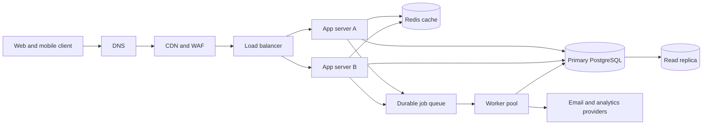

# QuickNotes service architecture

## Requirements

### Functional requirements

- Users can register, sign in, and sign out.
- Authenticated users can create, read, update, delete, search, and tag their notes.
- Notes are private to their owner.
- The API returns predictable JSON errors and supports pagination.
- Changes are durable and asynchronous work such as notifications does not block note writes.

### Non-functional requirements

- 99.9% monthly availability for the API.
- P95 read latency below 300 ms and P95 write latency below 500 ms.
- TLS in transit, encrypted database backups, hashed passwords, and audit logs.
- Horizontal scaling, automated backups, point-in-time recovery, and observable health metrics.
- Rate limiting and request IDs for abuse prevention and support diagnostics.

## Initial load estimate

Assume 1 million registered users, 20% daily active users, and each active
user reads 30 notes and writes 3 notes per day. This gives:

| Measure | Estimate | Capacity target |
| --- | ---: | ---: |
| Average reads per second | 69 | 350 reads/s, allowing a 5x peak |
| Average writes per second | 7 | 35 writes/s, allowing a 5x peak |
| New note storage per year | 1.1 TB raw | 2.5 TB with indexes, replicas, and growth |

The storage estimate assumes roughly 2 KB of note and index data per write:
`365 days * 1.2M active-user-days * 3 writes * 2 KB`, rounded up for metadata,
indexes, backups, and growth. Traffic and storage should be re-estimated from
production metrics before a major capacity purchase.

## Architecture

The client provides the user interface and sends authenticated API requests.
DNS provides a stable hostname and health-aware routing. The CDN and WAF
cache safe public assets and block common malicious traffic. The load balancer
spreads requests across healthy application servers. Two or more stateless app
servers allow horizontal scaling and keep one server failure from taking down
the API. Redis reduces repeated reads and absorbs hot-key traffic. The
primary database is the transactional source of truth for writes. The read
replica handles read-heavy queries without competing with writes. The durable
queue separates slow or retryable jobs from user-facing requests. Workers
process queued jobs with retries and idempotency. External providers deliver
notifications or analytics without coupling those delays to the API response.

## GET /notes flow

1. The client resolves `api.quicknotes.example` through DNS and sends a TLS request.
2. The CDN/WAF validates the request and forwards the API call to the load balancer.
3. The load balancer selects a healthy app server.
4. The app server authenticates the token, validates pagination and search parameters,
   and checks Redis for a user-scoped cache entry.
5. On a cache miss, the app server queries the read replica using the owner and
   indexed sort columns.
6. The app server stores a short-lived result in Redis and returns a paginated
   JSON response through the load balancer and CDN.

## POST /notes flow

1. The client sends the note over TLS with its access token and JSON body.
2. The WAF and load balancer route the request to a healthy app server.
3. The app server authenticates the user, validates the title and body, and
   starts a database transaction.
4. The transaction inserts the note and any note-tag links in the primary
   database, then commits before responding with `201 Created`.
5. The app server invalidates affected Redis keys and publishes a durable
   indexing, notification, or analytics job to the queue.
6. A worker processes the job with retries; failures remain visible in a
   dead-letter queue and do not lose the already-committed note.

## Trade-offs and failure avoidance

**Read replicas versus read-after-write consistency:** replicas improve read
throughput and protect the primary, but replication lag can briefly hide a new
note. After a write, the client can use the write response immediately and the
service can route a user's short consistency window to the primary.

**Cache speed versus invalidation complexity:** Redis lowers latency and
database load, but stale entries are possible. User-scoped keys have short
TTLs, writes explicitly invalidate affected keys, and a cache outage falls
back to the database rather than preventing reads.

**Asynchronous jobs versus operational complexity:** the queue keeps API
latency predictable, but requires monitoring and idempotent consumers. Durable
messages, multiple worker instances, retries, and a dead-letter queue prevent
one worker failure from losing work.

There is no intentional single point of failure in the request path: DNS uses
health checks, the CDN/WAF and load balancer are managed across zones, app
servers run in at least two zones, Redis uses a replicated cluster, PostgreSQL
has a synchronous standby and automated failover, and the queue and workers
run redundantly. Backups are stored separately and restore drills verify the
database recovery plan.
